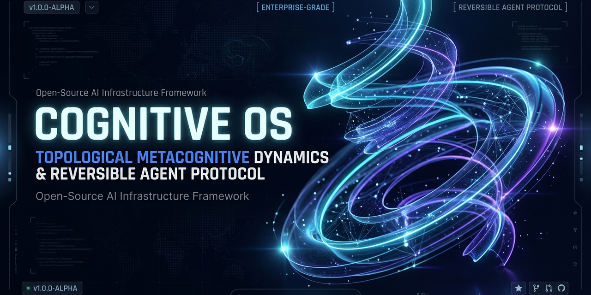

<div align="center">



# Cognitive OS & Topological Metacognitive Dynamics

**A Production-Grade Topological Calculus & Reversible Agent Controller (RAC) Framework**

[](https://opensource.org/licenses/Apache-2.0)
[](https://cognitive-os-dynamics.pages.dev)
[](CONTRIBUTING.md)
[]()
[]()
[]()

[**Live Interactive Platform**](https://cognitive-os-dynamics.pages.dev) • [**Lecture Slides (Bilingual)**](assets/) • [**Academic Monograph**](#academic-monograph) • [**Quickstart**](#quick-start)

</div>

---

## 🌌 Overview

Modern large language model (LLM) agents and autonomous workflows routinely collapse into **two catastrophic failure modes** during multi-step reasoning:
1. **Planar Limit-Cycle Traps**: Getting trapped in closed 2D parameter attractor basins, yielding repetitive, uncreative loops without elevation.
2. **Irreversible Action Cascades**: Expanding physical action throughput ($C_{\text{action}}$) beyond cognitive verification capacity ($C_{\text{cognition}}$), blowing out the **Action Scissors Gap ($SG$)** and inducing unrecoverable system damage.

**Cognitive OS** resolves both bottlenecks by synthesizing non-linear continuous dynamical systems, the **Spectral Spiral Equation**, and the **Reversible Agent Controller (RAC)** into an isomorphic, cross-scale operational runtime.

---

## ⚡ Key Architectural Pillars

### 1. 3D Topological Phase-Space Evolution Engine
* **Hopf Bifurcation Elevation**: Proves mathematically that injecting a non-zero **Metacognitive Shift Vector $\Delta S(t)$** induces supercritical bifurcations, transforming trapped 2D planar orbits into vertically ascending helical manifolds.
* **Canvas Native Simulator**: Interactive 3D trajectory tracking with real-time curvature tensor ($g_{\mu\nu} = \text{diag}(1,1,1)$) calculation and viewport manipulation.

### 2. RAC Reversible Agent Controller & N-1-0 Protocol
* **Scissors Gap Real-Time Telemetry**:
  $$SG(t) = |C_{\text{action}}(t) - C_{\text{cognition}}(t)|$$
* **Autonomous Circuit Breaker**:
  $$\lim_{SG \to SG_{\text{crit}}} \Phi_{\text{RAC}}(S) \longrightarrow S_0 \quad (\text{N-1-0 Protocol})$$
  When $SG \ge 70$, write tokens are instantly revoked, suspending execution and executing zero-loss state rollback to trusted baseline $S_0$.

### 3. Five-Scale Isomorphic Governance & Z-Scale Assessment
* Homomorphic conservation laws mapping across five natural tiers:
  $$\text{Micro Synapse} \longleftrightarrow \text{Individual Mind} \longleftrightarrow \text{Organization} \longleftrightarrow \text{Civilization} \longleftrightarrow \text{Planetary Biosphere}$$
* **Tripartite Diagnostic Data Export**: One-click export to **CSV**, **JSON**, and formatted **Printable PDF Academic Reports**.

---

## 🚀 Quick Start

### Option A: Direct Deployment via Cloudflare Pages & Wrangler

Clone and deploy the self-contained production bundle in under 15 seconds:

```bash
# 1. Clone repository
git clone https://github.com/your-username/cognitive-os.git
cd cognitive-os

# 2. Deploy directly to Cloudflare Pages globally
npx wrangler pages deploy . --project-name cognitive-os-dynamics
```

### Option B: Local Browser Run
Simply double-click or serve `index.html` with any HTTP static server:
```bash
npx serve .
```

---

## 📐 Mathematical Formulation

### Spectral Spiral Differential Evolution Equation
$$\mathbf{S}(t) = e^{(\alpha + i\omega)t}\mathbf{v}_0 + \int_0^t e^{(\alpha + i\omega)(t-\tau)}\Delta \mathbf{S}(\tau)d\tau$$

* $\alpha$: Damping and dissipation factor (stability boundary $\Re(\alpha) \le 0$).
* $\omega$: Intrinsic oscillation angular frequency.
* $\Delta \mathbf{S}(\tau)$: Metacognitive shift vector governing dimensional elevation.

---

## 📚 Academic Monograph Citation

If you incorporate this framework or the RAC N-1-0 protocol into your research, please cite:

```bibtex
@article{cognitive_os_2026,
  title={Topological Metacognitive Dynamics and Reversible Agent Control: From Spectral Spirals to Cross-Scale Isomorphic Governance},
  author={Cognitive Topology Lab and Reversible Intelligence Group},
  journal={Cognitive OS Working Paper Series},
  year={2026},
  doi={10.1038/s41586-026-topol-0921},
  url={https://cognitive-os-dynamics.pages.dev}
}
```

---

## 📄 License

Distributed under the **Apache 2.0 License**. See [`LICENSE`](LICENSE) for details.
